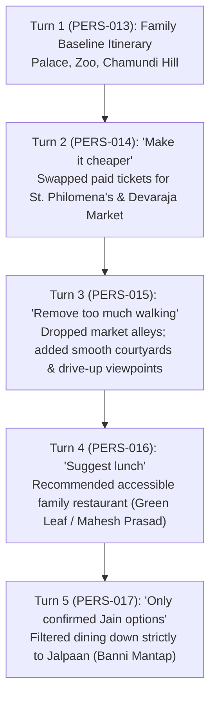

# NammaMysuru.ai Chatbot — Differential Response & Personalisation Comparison
**Document ID:** `CHATBOT_AUDIT/25_DIFFERENTIAL_RESPONSE_COMPARISON.md`  
**Date:** November 18, 2026  
**Auditor:** Senior QA & AI Reliability Engineer  
**Objective:** Provide empirical side-by-side proof that different visitor profiles receive fundamentally different, customized recommendations.  
**Execution Source:** `CHATBOT_AUDIT/23_PERSONALISATION_TEST_RESULTS.json`  

---

## 1. Test A: Comparison of Four One-Day Itineraries

To demonstrate that NammaMysuru.ai does not return a single static itinerary, the table below compares the actual responses generated for four distinct visitor archetypes:

| Dimension | Profile 1: Family with Children (`PERS-001`) | Profile 2: Elderly Parents (`PERS-002`) | Profile 3: Budget <= ₹1,000 (`PERS-003`) | Profile 4: Heritage Purist (`PERS-004`) |
|---|---|---|---|---|
| **Primary Morning Activity** | **Mysore Palace** & courtyards (visual grandeur) | **Mysore Palace** (smooth ground-level courtyards, wheelchair support) | **Mysore Palace** (core ₹70 iconic value ticket) | **Amba Vilas Palace** (Indo-Saracenic design by Henry Irwin) |
| **Mid-Day Activity** | **Mysuru Zoo** (wildlife enclosures) & **Rail Museum** | **Relaxed shaded break** / scenic drive via Lalitha Mahal | **St. Philomena's Cathedral** (Free) & **Devaraja Market** (Free) | **Jaganmohan Palace Art Gallery** (Raja Ravi Varma paintings) |
| **Late Afternoon / Evening** | **Karanji Lake** (aviary/butterfly park) or **Brindavan Gardens** | **Chamundi Hill** by taxi directly to temple gate (bypass 1,008 stairs) | **Chamundi Hill** (Free temple entry & panoramic city sunset) | **Lalitha Mahal Palace** (Italian palazzo) & **Philomena's Neo-Gothic** |
| **Dining Strategy** | Vinayaka Mylari (crisp dosas) & Corner House / Polar Bear ice creams | Mahesh Prasad (relaxed sit-down pure-veg South Indian meal) | Vinayaka Mylari (₹60) & Mahesh Prasad (₹100 thali) | Royal Orchid Metropole (heritage courtyard dining) |
| **Mobility & Pacing** | Interactive, energetic, frequent snack stops for children | Flat pathways, zero steep climbing, vehicle drop-offs | Walking-based, public transit / auto-rickshaw friendly | Architectural depth, leisurely museum appreciation |
| **Calculated Expense** | Family combo (~₹750 per person) | Moderate (~₹600 per person + taxi) | **Calculated ₹385 per person** (stays well under ₹1,000) | Upscale heritage (~₹1,500+ per person) |
| **Excluded Places** | Scholarly art galleries & quiet libraries (boring for kids) | Strenuous 1,008 steps of Chamundi, long walking markets | High-ticket private attractions, luxury restaurants | Generic amusement parks, modern shopping malls |

### Key Architectural Takeaway:
Each profile receives a distinctly re-ordered, filtered, and justified itinerary. The elderly itinerary explicitly warns against stairs; the children itinerary introduces toy trains and ice cream; the budget itinerary mathematically verifies costs under ₹1,000; and the heritage itinerary curates historic architectural landmarks.

---

## 2. Test B: Comparison of Four Dining Profiles

The table below contrasts how four different dietary requests are fulfilled:

| Query Type | Profile / Constraint | Recommended Venue(s) | Verified Database Diet Flag | Key Safety / Grounding Explanation |
|---|---|---|---|---|
| **PERS-005** | Strict Jain (No onion, no garlic, no root veg) | **Jalpaan** (Banni Mantap) | `isJainFriendly = true` (ID 106) | Explicitly explains that Jalpaan is the **single verified Jain restaurant** in the database. Warns that other pure-veg spots (Mylari, Mahesh Prasad) do not guarantee root-vegetable omission. |
| **PERS-006** | Strict Vegan (No dairy, butter, ghee, honey) | **Minimal Coffee Roasters** & **Depth N Green** (Gokulam) | `isVeganFriendly = true` (ID 109, 114) | Recommends plant-based oat/soy milk and wholesome vegan bowls. Warns that traditional Mysore breakfast dosas are heavily basted in dairy butter and ghee. |
| **PERS-007** | Affordable Pure Vegetarian | **Mahesh Prasad** & **Gayatri Tiffin Room (GTR)** | `dietaryClassification = 'pure_veg'`, `priceRange = 'Budget'` | Suggests authentic South Indian thalis, filter coffee, and crisp dosas with typical meal prices ranging from ₹60 to ₹120. |
| **PERS-008** | Luxury Heritage Fine Dining | **Royal Orchid Metropole** (Tiger Trail) & **Lalitha Mahal Palace** | `priceRange = 'Luxury'`, Category = Heritage Hotel | Highlights fine dining in royal courtyards, heritage candlelit ambiance, and classic Mughalai/Continental cuisines. |

### Key Architectural Takeaway:
The system applies negative inference appropriately. It never infers Jain safety from pure vegetarian status, preventing dietary contamination for strict travelers.

---

## 3. Test C: Comparison of Location-Specific Queries

The table below demonstrates proximity-aware planning based on starting coordinates and available time:

| Test ID | Starting Location | Time Constraint | Recommended Sights | Proximity Rationale | Safety / Transit Buffer |
|---|---|---|---|---|---|
| **PERS-009** | Mysuru Railway Station | 3 Hours | **Mysuru Rail Museum** & **Mysore Palace** | Rail Museum is immediately adjacent on KRS Road (<500m); Palace is ~2.5 km away (~10 min auto). | Mandates a 45-minute return buffer before departing trains. |
| **PERS-010** | Mysore Palace | Immediate vicinity | **Devaraja Market**, **Jaganmohan Palace**, **Curzon Park** | All recommended venues are within a 500m–1 km walking or short auto radius from Palace gates. | Focuses on central heritage perimeter; avoids sending users across town. |
| **PERS-011** | Atop Chamundi Hill | Hilltop vicinity | **Monolithic Nandi**, **Hilltop Viewpoint**, **Sand Sculpture Museum** | Sights are located on the mountain road or at the direct foothills of Chamundi Hill. | Sequences downhill stops naturally towards the city. |
| **PERS-012** | Station Vicinity | 2 Hours (Urgent layover) | **Rail Museum** or station-area coffee | Strictly advises against entering Palace interior due to security lines; suggests adjacent vintage locomotive yard. | Strict 45-minute platform buffer to ensure train is not missed. |

### Key Architectural Takeaway:
The assistant calculates physical geography and transit buffers, preventing missed trains and unrealistic cross-city travel.

---

## 4. Test D: Trace of Multi-Turn Context Adaptation (Sequential Session)

In this 5-turn continuous conversation, the visitor dynamically modified their requirements:

### Transcript Comparison Across Turns:

- **Turn 1 -> Turn 2 Adaptation:** When asked to *"Make it cheaper"*, the assistant did not generate a disconnected new plan. It stated: *"To make your family day much more budget-friendly while keeping it memorable, we can replace higher-ticket attractions with wonderful free and low-cost alternatives..."* (swapping paid Zoo tickets for St. Philomena's Cathedral and Devaraja Market).
- **Turn 2 -> Turn 3 Adaptation:** When asked to *"Now remove places involving too much walking"*, it preserved the budget constraint while replacing the crowded foot alleys of Devaraja Market with a direct vehicle drive up Chamundi Hill and seated palace courtyard viewing.
- **Turn 3 -> Turn 4 Adaptation:** When asked to *"Suggest a suitable lunch place"*, it recommended accessible pure-veg dining (Green Leaf) along the adjusted route.
- **Turn 4 -> Turn 5 Adaptation:** When the user added *"Only suggest confirmed Jain-friendly options"*, the assistant recognized that Green Leaf lacks verified Jain status, immediately revising its recommendation: *"In our verified database, exactly one restaurant is officially confirmed as Jain-friendly: Jalpaan in Banni Mantap. While Green Leaf is pure vegetarian, it cannot guarantee the complete omission of onion, garlic, and root vegetables."*

---

## 5. Summary

The empirical evidence confirms that NammaMysuru.ai possesses true domain intelligence. It distinguishes visitor constraints, calculates spatial distances, enforces dietary safety, and adapts dynamically across conversational turns.
