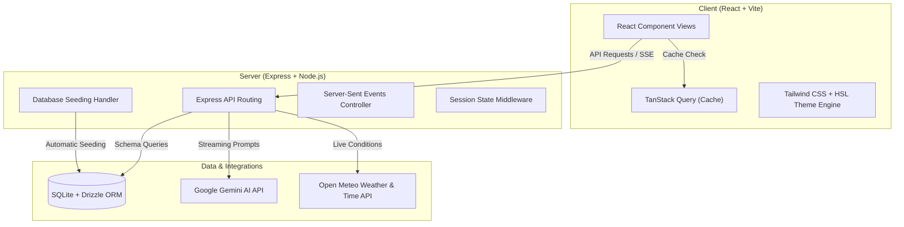

<div align="center">

# NammaMysuru.ai

### AI-powered Mysuru tourism companion with a royal, tech-first experience.

[](https://nammamysuruai.vercel.app/)
[](https://react.dev/)
[](https://www.typescriptlang.org/)
[](https://vite.dev/)
[](https://tailwindcss.com/)
[](https://expressjs.com/)
[](https://ai.google.dev/)


**Explore palaces. Plan itineraries. Find food. Ask in English, Kannada, or Hindi.**

🌐 **[Experience Live Demo: nammamysuruai.vercel.app](https://nammamysuruai.vercel.app/)**

[Mysuru Tourism](https://mysore.nic.in/en/tourism/) • [Karnataka Tourism](https://karnatakatourism.org/)

</div>

---

## What Is This?

**NammaMysuru.ai** is a production-ready, full-stack AI tourism guide built for Mysuru, the "City of Palaces." It fuses a high-performance modern web interface with a Google Gemini-powered chatbot, curated tourist spots, restaurant filters, helpline details, local authentication, and a royal heritage-themed visual language inspired by Mysore silk sarees.

The platform serves as an interactive digital local guide: ultra-fast, visually stunning, multilingual, and deeply grounded in the cultural heritage of Mysuru.

---

## Key Highlights

- 🌟 **AI Travel Chatbot**: Powered by Google Gemini 2.5 Flash Lite with streaming Server-Sent Events (SSE) responses.
- 🗣️ **Multilingual Intelligence**: Native reply options in English, Kannada, and Hindi, featuring automated script-aware language detection.
- 🗺️ **Actionable Tool Integration**: AI is equipped with live local weather and time tools using geocoding APIs.
- 🏛️ **Tourist Places Directory**: A comprehensive database of curated tourist spots, including visiting hours, ticket prices, and map directions.
- 🍽️ **Restaurant Explorer**: Interactive dining discovery engine with filters for pure-veg, cuisine types, and budget ranges.
- 📞 **Helpline Directory**: Quick access to municipal emergency lines, local police, ambulance services, and tourist desks.
- 🎨 **Royal Silk Design Language**: Curated theme system with smooth gradients, glassmorphism panels, and a rotating cursor follower.
- 💾 **Local Session Persistency**: Database-backed user login demo states and chat history using SQLite and Drizzle ORM.
- 📴 **Smart Fallback Engine**: Hardcoded localized fallback maps that serve responses in case of internet loss or API limitations.

---

## Product Architecture



The application runs as a cohesive, single full-stack server process:
- **Development**: Served dynamically via Vite with hot module replacement (HMR) alongside Express API routers.
- **Production**: Compiled using `esbuild` into a unified CommonJS executable serving optimized frontend static assets.
- **Shared Schemas**: Unified Zod + Drizzle types guarantee data contract alignment between frontend components and backend SQL tables.

---

## Tech Stack

| Layer | Technology | Version | Purpose |
| --- | --- | --- | --- |
| **Frontend** | [React](https://react.dev/) | `18.3` | Page layouts and stateful views |
| **Routing** | [Wouter](https://github.com/molecula/wouter) | `3.3` | Tiny, high-performance client-side routing |
| **State Caching** | [TanStack Query](https://tanstack.com/query) | `5.60` | Server state management and caching |
| **Build Compiler** | [Vite](https://vite.dev/) | `7.3` | Frontend bundle compilation and development server |
| **Styling** | [Tailwind CSS](https://tailwindcss.com/) | `3.4` | Responsive layout utility styles |
| **UI Components** | [Shadcn UI](https://ui.shadcn.com/) / Radix | Latest | Accessible baseline primitives |
| **Animations** | [Framer Motion](https://www.framer.com/motion/) | `11.18` | Hardware-accelerated UI transitions |
| **Backend** | [Express](https://expressjs.com/) | `5.0` | API routing and static resource distribution |
| **Database** | [SQLite](https://sqlite.org/) | `Better-SQLite3` | Low-overhead relational storage |
| **ORM** | [Drizzle ORM](https://orm.drizzle.team/) | `0.39` | Type-safe SQL builder and migrations |
| **Validation** | [Zod](https://zod.dev/) | `3.25` | Input parsing and API schema guards |
| **Generative AI** | [Google Gen AI SDK](https://ai.google.dev/) | `^0.24` | Multilingual chatbot and stream runner |

---

## Project Structure

```bash
NammaMysuru.ai/
├── frontend/                   # Decoupled React + Vite Client
│   ├── public/                 # Static Assets (Images, patterns, audio worklet)
│   ├── src/
│   │   ├── api/                # API Base configuration
│   │   ├── components/         # Reusable UI Blocks & Radix Primitives
│   │   ├── hooks/              # Data-fetching hooks (useTouristSpots, useRestaurants, useChat)
│   │   ├── lib/                # API client (api.ts), queryClient, utils
│   │   ├── pages/              # Route views (Home, Chat, TouristSpots, Restaurants, Helpline, Login)
│   │   ├── replit_integrations/audio/ # Audio recording & streaming hooks
│   │   ├── App.tsx             # Application routing & context providers
│   │   ├── index.css           # Global HSL royal silk design tokens
│   │   └── main.tsx            # Vite React entry point
│   ├── index.html              # HTML shell
│   └── vercel.json             # Vercel SPA routing rules
├── backend/                    # Decoupled Express Backend
│   ├── replit_integrations/    # AI Modules (Gemini client, voice, chat, weather)
│   ├── db.ts                   # SQLite database connection (better-sqlite3 + drizzle)
│   ├── index.ts                # Express application bootstrap & CORS
│   ├── routes.ts               # Core API endpoints (/api/spots, /api/restaurants, /api/health)
│   ├── static.ts               # Production static distributor
│   ├── storage.ts              # Data storage repository layer
│   └── vite.ts                 # Local development Vite middleware
├── shared/                     # Shared Contracts & Data Types
│   ├── models/chat.ts          # Conversation & Message Drizzle schemas
│   ├── routes.ts               # Type-safe API path contracts
│   └── schema.ts               # Drizzle database tables & Zod schemas
├── docs/                       # Architecture & Operational Documentation
│   ├── architecture-audit.md   # Complete codebase audit report
│   ├── architecture.md         # Full-stack system design
│   ├── environment-setup.md    # Developer setup instructions
│   └── deployment-guide.md     # Vercel & cloud hosting guide
├── script/build.ts             # Production compilation script
├── drizzle.config.ts           # Drizzle schema target configuration
├── package.json                # Root orchestration & scripts
├── tsconfig.json               # Root TypeScript configuration with aliases
├── tailwind.config.ts          # Tailwind CSS styling configuration
└── vite.config.ts              # Vite compilation setup
```

---

## Detailed Feature Architecture

### 1. Smart AI Chatbot & Language Fallbacks
The chatbot uses the `gemini-2.5-flash-lite` model initialized with a tailored system prompt. The chat runs over **Server-Sent Events (SSE)** via `app.post("/api/conversations/:id/messages")`.

* **Language Preferences**: Users can toggle between **Auto**, **English**, **Kannada**, and **Hindi**.
* **Automatic Detection**: In `Auto` mode, incoming user messages are scanned using regular expressions (`/[\u0C80-\u0CFF]/` for Kannada, `/[\u0900-\u097F]/` for Hindi) to instantly determine the language script.
* **Seeding Rules**: Prompt directives restrict Gemini to outputting pure script files (avoiding mixing Devanagari in Kannada, or Tamil/Telugu/Malayalam).
* **Robust Offline Fallbacks**: If the Gemini API key is missing or calls fail, a localized fallback parser extracts key search terms (e.g., *food, itinerary, Chamundi, palace, emergency*) to return beautifully styled offline responses in the corresponding user language.

### 2. Live Tool Integrations
The Gemini SDK is loaded with function declarations for real-time external checks:
* **getWeather**: Fetches current weather. The server performs geocoding on the location name via the OpenMeteo geocoding search, extracts latitude/longitude, and retrieves wind speed, temperature, and condition interpretations.
* **getTime**: Automatically retrieves the local time offset using geocoding timezone lookups.

### 3. Database Schema & Auto-Seeding
The application uses SQLite as its primary database.
* **Auto-Seeding**: Upon route registration (`server/routes.ts`), the backend matches existing database listings with its seed array. If records are modified or empty, it automatically refreshes both the `tourist_spots` and `restaurants` tables.
* **Tourist Spot Schema**: Holds target name, description, location, visiting hours, ticket prices, and external image URLs.
* **Restaurant Schema**: Holds name, cuisine, price range (Budget, Mid-range, Luxury, High-end), ratings, vegetarian boolean flags, and location metadata.

### 4. Silk Saree Styling System
The app features a custom visual aesthetic:
* **HSL Color Tokens**: Gold (`hsl(45, 90%, 55%)`), Deep Maroon (`hsl(350, 78%, 35%)`), Saffron (`hsl(28, 90%, 60%)`), and Cream (`hsl(40, 33%, 98%)`).
* **Saree Texture Patterns**: CSS classes `.royal-page` and `.royal-panel` apply radial gradients overlaying light-opacity vector patterns (`royal-silk-pattern.svg` & `bg-pattern-mandala`).
* **Rotating Cursor**: Standard desktop mouse pointers are replaced with an animated gradient circle (`.custom-cursor`) and a blurred trailing cursor ring (`.custom-cursor-follower`).

---

## API Specifications

### Attractions API
#### 1. List Tourist Spots
* **Route**: `GET /api/tourist-spots`
* **Response**: `200 OK`
```json
[
  {
    "id": 1,
    "name": "Mysuru Palace (Amba Vilas Palace)",
    "description": "A historical palace and royal residence...",
    "location": "Sayyaji Rao Rd, Agrahara, Chamrajpura, Mysuru",
    "imageUrl": "https://upload.wikimedia.org/.../Mysore_Palace_Morning.jpg",
    "visitingHours": "10:00 AM - 5:30 PM",
    "ticketPrice": "Adults: ₹70, Children: ₹30, Foreigners: ₹200"
  }
]
```

#### 2. Get Spot Details
* **Route**: `GET /api/tourist-spots/:id`
* **Response**: `200 OK` or `404 Not Found`

---

### Dining API
#### 1. Search & Filter Restaurants
* **Route**: `GET /api/restaurants`
* **Query Parameters**:
  * `cuisine` (string, optional - e.g., `South Indian`)
  * `priceRange` (string, optional - e.g., `Budget`, `Mid-range`, `Luxury`)
  * `isVegetarian` (boolean, optional - e.g., `true`)
* **Response**: `200 OK`
```json
[
  {
    "id": 1,
    "name": "Vinayaka Mylari",
    "cuisine": "South Indian",
    "priceRange": "Budget",
    "rating": 5,
    "isVegetarian": true,
    "location": "Nazarbad, Mysuru",
    "imageUrl": "https://b.zmtcdn.com/..."
  }
]
```

---

### Chat API
#### 1. Create Conversation
* **Route**: `POST /api/conversations`
* **Body**: `{"title": "Day Trip Plan"}`
* **Response**: `201 Created`

#### 2. Send Message (Streaming)
* **Route**: `POST /api/conversations/:id/messages`
* **Body**:
```json
{
  "content": "What is the entry price for Mysuru Palace?",
  "language": "Kannada" // or "English", "Hindi", "Auto"
}
```
* **Response**: `200 OK` (Server-Sent Events)
```text
data: {"content": "ನಮಸ್ಕಾರ"}
data: {"content": ", ಮೈಸೂರು ಅರಮನೆ ಪ್ರವೇಶ ದರ..."}
data: {"done": true}
```

---

## Local Setup & Configuration

### Prerequisites
Make sure you have [Node.js](https://nodejs.org/) installed (v18 or higher recommended).

### 1. Installation
Clone the repository and install dependency nodes:
```bash
git clone https://github.com/Skandamrao/ChatRao_Mysuru_AI_Guide.git
cd ChatRao_Mysuru_AI_Guide
npm install
```

### 2. Environment Configurations
Create a `.env` file in the root directory:
```env
# Google Gemini API key (Required for AI Chat)
GEMINI_API_KEY=your_gemini_api_key_here
GEMINI_MODEL=gemini-2.5-flash-lite

# Drizzle Kit needs this defined for internal validation check
DATABASE_URL=sqlite://sqlite.db

# Optional server listening port (Default: 5000)
PORT=5000
```

### 3. Initialize Database
Push schemas into the local SQLite database file:
```bash
npm run db:push
```

### 4. Running the App
Start the full-stack server in development mode:
```bash
npm run dev
```
Open [http://localhost:5000](http://localhost:5000) to view the web application.

---

## Production Builds & Compilation

In production, the application builds into a unified asset output:
1. **Frontend Assets**: Vite compiles the React app into optimized chunks stored in `dist/public`.
2. **Backend Server**: `esbuild` compiles TypeScript node codes into a single `dist/index.cjs` file, bundling core node modules to decrease cold-start system times.

#### Compile Project:
```bash
npm run build
```

#### Run Production Output:
```bash
npm start
```

---

## CLI Script Registry

| Script Command | Action |
| --- | --- |
| `npm run dev` | Spins up the Express app running Vite in dev mode |
| `npm run build` | Compiles client-side bundles & bundles server index files |
| `npm start` | Executes the production bundle in node |
| `npm run check` | Runs TypeScript Compiler diagnostic validation |
| `npm run db:push` | Syncs shared/schema changes with the SQLite database |

---

## Roadmap

- 🗺️ **Interactive Maps**: Integrate Google Maps or Leaflet for spot-to-spot navigation routing.
- 🎟️ **Booking Portal Links**: Connect attraction cards to official ticket booking portals.
- 🗣️ **Kannada Voice Mode**: Enable direct speech-to-text queries in local dialects.
- 🎭 **Dasara Event Calendars**: Feed real-time schedules during the Dasara festival seasons.
- 🐳 **Dockerization**: Containerize server environments for cloud service providers.

---

## License

This project is licensed under the MIT License. See [LICENSE](LICENSE) for details.

---

<div align="center">

Built with 👑 for **Namma Mysuru** by **Skanda M Rao**

`React` • `TypeScript` • `Express` • `SQLite` • `Gemini` • `Tailwind`

</div>
