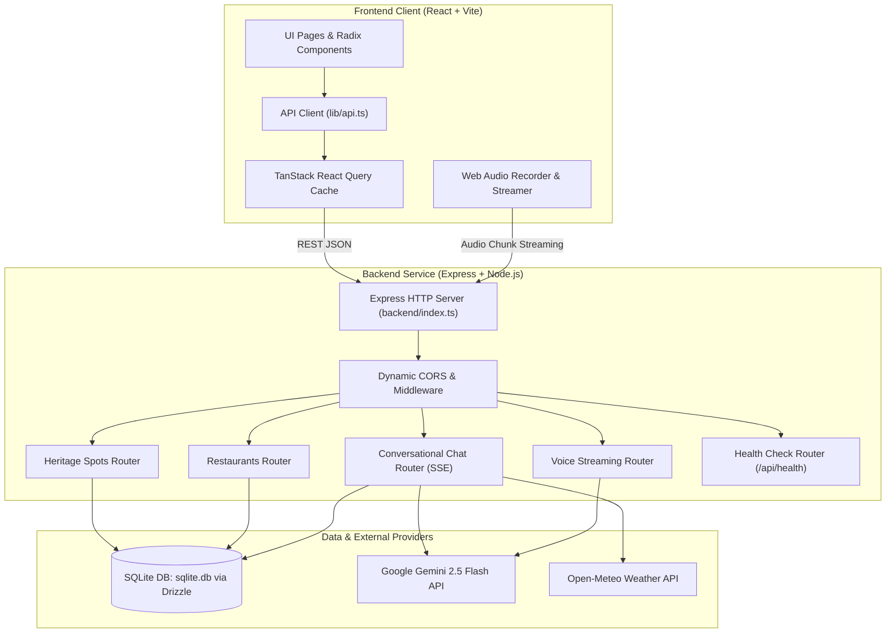

# System Architecture & Component Design: NammaMysuru.ai

## 1. Architecture Overview

NammaMysuru.ai employs a clean full-stack architecture with decoupled frontend and backend layers, tied together with shared type contracts.

---

## 2. Layer Boundaries & Responsibilities

### Frontend (`frontend/`)
- **Scope**: Browser-only SPA execution.
- **Components**:
  - `src/pages/`: Route targets (`Home`, `Chat`, `TouristSpots`, `Restaurants`, `Helpline`, `Login`).
  - `src/components/`: Modular UI system built on Tailwind CSS and Radix UI primitives.
  - `src/hooks/`: Data-fetching hooks (`useTouristSpots`, `useRestaurants`, `useChat`, `useVoiceStream`).
  - `src/lib/api.ts`: Central endpoint resolution. Dynamically uses `VITE_API_BASE_URL` when specified, or relative routes in local dev.
  - `public/`: Images, vector graphics, and Web Audio worklets.

### Backend (`backend/`)
- **Scope**: Express HTTP API server and external service orchestration.
- **Components**:
  - `index.ts`: Application bootstrap, CORS middleware, body parsers, and error handling.
  - `routes.ts`: Core REST routes for tourist attractions, dining, and system health.
  - `storage.ts`: Repository operations interfacing with Drizzle ORM.
  - `db.ts`: SQLite database handle.
  - `replit_integrations/`:
    - `gemini_client.ts`: Google Generative AI client with fallback protection.
    - `chat/routes.ts`: Multi-lingual conversational pipeline with function-calling tools.
    - `audio/routes.ts`: Base64 audio decoding and streaming synthesis.
    - `weather.ts`: Real-time weather provider.

### Shared Layer (`shared/`)
- **Scope**: Shared validation schemas and contracts.
- **Components**:
  - `schema.ts`: Drizzle table definitions and Zod insert schemas.
  - `routes.ts`: Standardized route paths and request/response Zod contracts.
  - `models/chat.ts`: Conversation and message entities.

---

## 3. Communication Patterns

1. **Standard REST Endpoints**:
   - `GET /api/spots`: Returns tourist spots with cache headers.
   - `GET /api/spots/:id`: Returns single spot details.
   - `GET /api/restaurants`: Returns restaurants with cuisine, price, and vegetarian filtering.
   - `GET /api/health`: Validates backend service availability.

2. **Server-Sent Events (SSE)**:
   - `POST /api/conversations/:id/messages`: Streams Gemini AI tokens chunk-by-chunk to the frontend in real time.
   - `POST /api/voice-conversations/:id/messages`: Accepts base64 audio and returns streaming transcribed response text.
